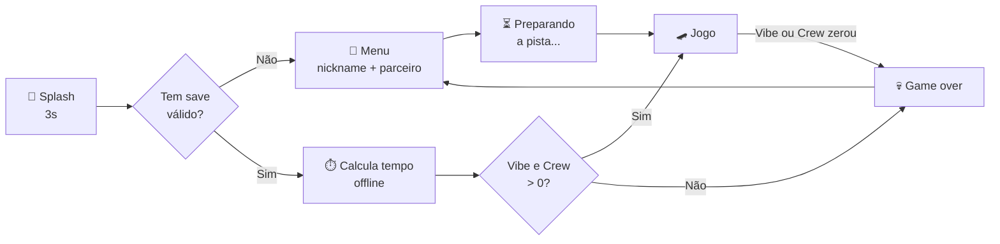

<div align="center">


# 🛹 SKATOGOSHI

### *Tamagotchi de patins no esgoto*


> *Bem-vindo ao submundo. Skatogoshi é um manifesto irônico sobre a cultura de rua e o absurdo da existência.
> Entre becos cyberpunks e a fumaça dos esgotos, as personagens tentam sobreviver ao apocalipse do jeito que dá.
> Pegue seu rolamento, ignore as regras e boa viagem.*

</div>

---

## 🐀 O que é isso?

**Skatogoshi** é um bichinho virtual no estilo Tamagotchi, só que em vez de alimentar um ovinho digital, você mantém viva a **vibe** de um parceiro de rolê que mora numa pista de skate no esgoto.

Ele roda direto no navegador, funciona no celular e **continua o tempo mesmo com a aba fechada**. Se você sumir por dias, a sua dupla sente falta. Se sumir demais, ela larga o skate de vez. 💀

---

## 🎮 Escolha seu parceiro de esgoto

<table align="center">
  <tr>
    <td align="center" width="200">
      <br>
      <b>Ratinha</b><br>
      <sub>Ágil e cheia de atitude.</sub>
    </td>
    <td align="center" width="200">
      <br>
      <b>Gregor Samsa</b><br>
      <sub>Fortemente construído e com muita energia.</sub>
    </td>
    <td align="center" width="200">
      <br>
      <b>Pomba Rola</b><br>
      <sub>Veloz e ágil, com um estilo único.</sub>
    </td>
  </tr>
</table>

---

## 📊 Os status

| Status | O que significa | Como cai | Se zerar... |
|:--|:--|:--|:--|
| ✨ **Vibe** | O astral da dupla. Sem andar de skate, ela some. | Cai sozinha até zerar em **3 dias** (~1,4% por hora) | ☠️ **Game over** |
| ⚡ **Energia** | O combustível pras manobras. | Só cai quando você faz ações | Você só não consegue mandar manobras |
| 🛹 **Crew** | A galera do rolê. Sem compartilhar o skate, ela se desfaz. | Cai sozinha até zerar em **7 dias** (~0,6% por hora) | ☠️ **Game over** |

## 🕹️ As ações

| Botão | Efeito |
|:--|:--|
| 🤘 **Mandar Manobra** | `+20%` Vibe · `−10%` Energia |
| 😴 **Descansar** | `+30%` Energia |
| 🧑‍🏫 **Ensinar Manobra** | `+20%` Crew · `−15%` Energia |
| 🗑️ **Resetar Save** | Apaga tudo e volta pra escolha de personagem |

> 💡 **Dica de lenda:** os botões de manobra ficam desativados quando falta energia. Descanse antes de tentar o kickflip.

---

## 🔄 Fluxo do jogo



---

## ✨ Destaques técnicos

- **💾 Save automático** em `localStorage` (chave `skatogoshi_save`), gravado a cada segundo e após cada ação.
- **⏰ Tempo offline real:** ao voltar, o jogo calcula quanto tempo passou desde o último acesso e aplica o desgaste proporcional. Se você ficou fora por mais de 1 hora, recebe um aviso.
- **🛡️ Save blindado:** um save corrompido ou inválido (JSON quebrado, status fora de 0–100, personagem desconhecido) é detectado e descartado sem quebrar o jogo.
- **🔁 Compatível com saves antigos:** campos das versões anteriores (`felicidade` e `pov`) são convertidos automaticamente para `vibe` e `crew`.
- **⚖️ Balanceamento centralizado:** todas as regras ficam no objeto `regrasDoJogo` em [`js/script.js`](./js/script.js). Dá pra deixar o jogo mais fácil (ou mais cruel) mudando só alguns números.
- **📱 Responsivo** com ajustes específicos para telas de até 450px.
- **♿ Acessível:** seleção de personagem com `radio` (funciona no teclado), `aria-label` nos grupos e um cenário com descrição dinâmica.
- **🪶 Zero dependências:** só HTML, CSS e JavaScript puro. Nada de build, nada de `npm install`.

---

## 🚀 Como rodar

Não precisa instalar nada.

```bash
git clone https://github.com/LaylaAquino/skatogoshi.git
cd skatogoshi
```

Depois é só abrir o `index.html` no navegador.

---

## 🗂️ Estrutura do projeto

```
skatogoshi/
├── index.html          # Telas: splash, menu, carregando e jogo
├── css/
│   └── style.css       # Visual neon-esgoto, fonte pixel e layout mobile
├── js/
│   └── script.js       # Estado, save, loop de tempo, regras e ações
└── img/
    ├── background-skatepark.jpg
    ├── icon-ratinha.png                         # Favicon
    └── craftpix-net-...-wraith-tiny-style-2d-sprites/  # Sprites dos personagens
```

---

## 🎨 Identidade visual

| Cor | Hex | Uso |
|:--:|:--|:--|
|  | `#FF3FD1` | Rosa neon, a cor principal |
|  | `#39D0EB` | Ciano dos detalhes |
|  | `#FDDD56` | Amarelo de destaque |
|  | `#050505` | O breu do esgoto |

Tipografia: **[Press Start 2P](https://fonts.google.com/specimen/Press+Start+2P)** para o clima pixel-art e **[Roboto](https://fonts.google.com/specimen/Roboto)** para o texto corrido.

---

## 🙏 Créditos

- **Sprites:** [Free Wraith Tiny Style 2D Sprites](https://craftpix.net/) da **CraftPix.net**. Licença: [craftpix.net/file-licenses](https://craftpix.net/file-licenses/).
- **Fontes:** Google Fonts.
- **Ideia, código e caos:** [@LaylaAquino](https://github.com/LaylaAquino).

---

<div align="center">

**Feito com 🛹, 🐀 e muita fumaça de esgoto.**

*Se a sua Vibe zerar, a culpa não é nossa.*

</div>
